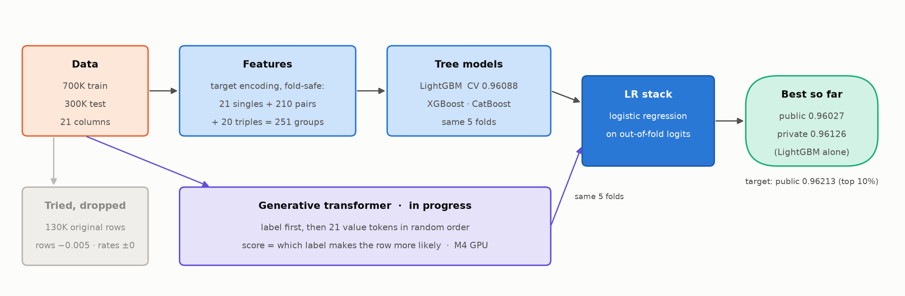
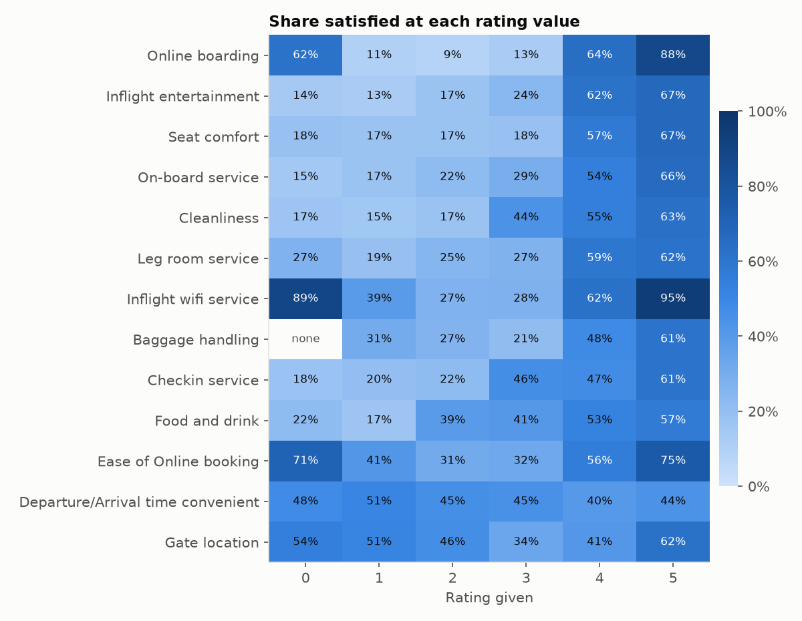
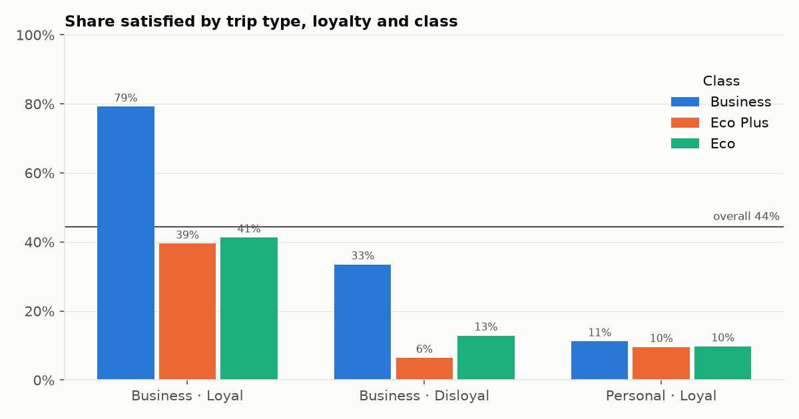
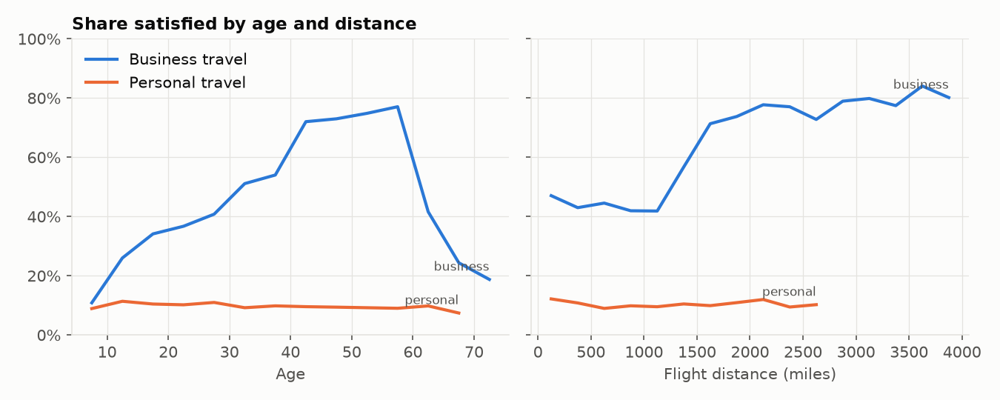
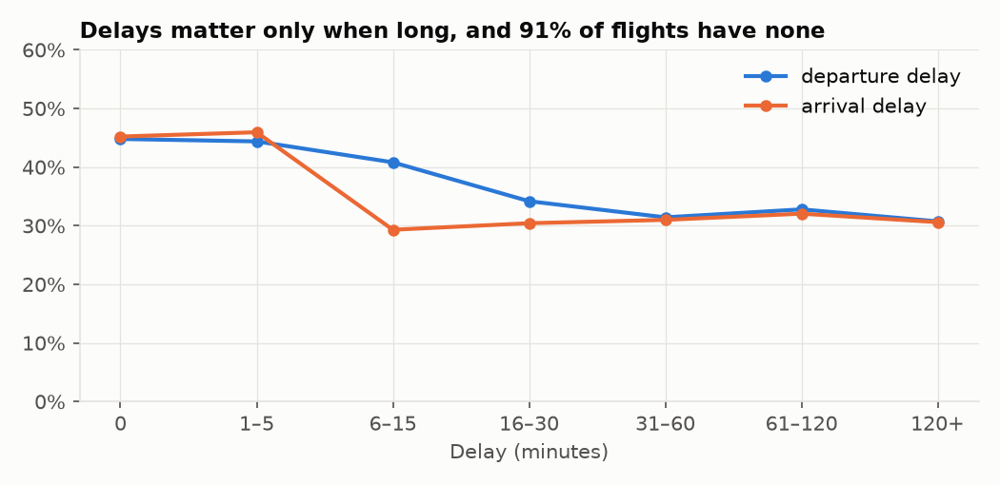
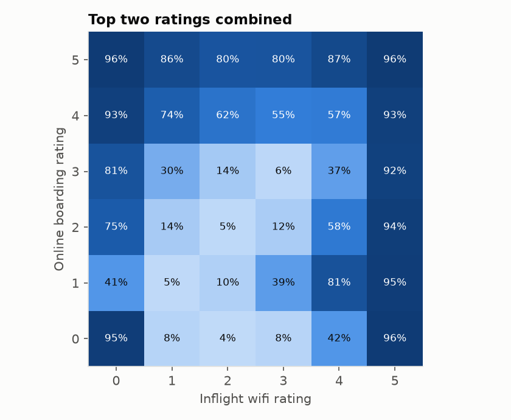

# Learning log

## Pipeline

Regenerate with `uv run python pipeline_diagram.py`. It shows the current state: tree models on target-encoded singles, pairs and triples, a generative transformer branch in progress, and the original dataset tried and dropped.

## EDA (`eda.py`)

- 699,635 train rows, 299,844 test rows, 21 features (13 ratings, age, flight distance, 2 delays, 4 categorical). 44.4% of passengers are satisfied, so the classes are close to balanced.
- The only missing values are in `Arrival Delay in Minutes` (292 train, 130 test).
- No duplicate rows. Train and test match closely: the largest gap in any feature's mean is 0.004 standard deviations, so a random stratified K-fold split should track the leaderboard.
- There are 13 survey ratings on a 0–5 scale. A 0 most likely means "not rated": `Baggage handling` never has a 0.
- The categorical columns carry a lot of signal on their own. Satisfaction rates by group:
  - Class: Business 73%, Eco 17%, Eco Plus 24%
  - Type of travel: business 58%, personal 10%
  - Customer type: loyal 50%, disloyal 20%
  - Gender: about 44% for both, so almost no signal
- Single-feature AUC: `Online boarding` scores 0.84 on its own, then Inflight entertainment 0.75 and Seat comfort 0.73. The delay columns, `Gate location` and departure/arrival time convenience are close to random (0.51–0.53).
- A HistGradientBoosting model with default settings gets 0.9579 AUC on a 20% holdout. Models on the original real dataset reach 0.99+, so the synthetic noise sets a much lower ceiling.

## Baseline (`train_lgb.py`)

- LightGBM on the raw features with 5-fold stratified CV: **out-of-fold AUC 0.95892**. The folds range from 0.9577 to 0.9597.
- First submission: **public 0.95836, private 0.95942**. The CV and leaderboard scores agree within about 0.0005, which confirms there's no meaningful drift between train and test.
- Leaderboard context: the competition closed on 2026-10-31 with 3,735 teams. On the **private** leaderboard (final standings) the winner scored 0.96318, and the top 20 are all between 0.9625 and 0.9632. On the **public** leaderboard the top score is 0.96473, but the top 3 public teams (0.9645–0.9647, 49–238 submissions each) aren't near the top of the private board: they overfit the public 20% of the test set. The public median is 0.95997, and top 10% needs 0.9622. Late submissions are scored but not ranked.

## Visual EDA (`figures.py`)

### A 0 rating isn't a bad rating

- Most ratings rise steadily from 1 to 5. `Online boarding` has the biggest range, from about 10% satisfied at ratings 1–3 to 88% at 5.
- **A 0 behaves nothing like a 1.** Passengers who gave wifi a 0 are 89% satisfied, and 0 on online booking or boarding gives 71% and 62%. In the original survey, 0 most likely means the service didn't apply (for example, no wifi on the flight). It's a separate category, not the bottom of the scale.
- Passengers with 3 or more zeros across their ratings are 86–94% satisfied, against a 44% average. That makes `n_zero` a real signal, although trees can find it without help.
- `Departure/Arrival time convenient` is flat at 40–51% and slightly *negatively* related to satisfaction. `Gate location` is U-shaped. Neither works as a plain ordered rating.

### Segments interact

- Loyal passengers on business trips in Business class are **79%** satisfied. Change only the class to Eco or Eco Plus and that drops to about 40%.
- Personal-travel passengers are about 10% satisfied **whatever their class**: paying for Business doesn't help them.
- Disloyal business travellers in Eco Plus are the least satisfied group, at 6%.
- The effect of one segment column depends on the others, which is why pair features are worth trying.

### Age and distance only matter for business trips

- For business travellers, satisfaction climbs with age to a plateau of about 75% at ages 40–58, then **collapses past 60** to about 20%. A single split can't capture that shape, so trees need several.
- Business travellers jump from about 42% to about 75% satisfied once flights pass ~1,200 miles, which probably reflects long-haul service.
- For personal travellers, both lines stay flat at about 10%.

### Delays mostly don't matter

- 91% of flights have no departure delay, so delay can't explain much overall.
- Even long delays only lower satisfaction from 45% to about 30%. Arrival delay has its effect earlier (from 6 minutes) than departure delay.
- The two delay columns are highly correlated (r = 0.84).

### The top two ratings interact strongly

- A **wifi rating of 5 gives 92–96% satisfaction whatever the boarding rating**, and a wifi rating of 0 behaves almost the same way.
- In the middle, the two ratings combine in non-additive ways: boarding 3 with wifi 3 is only 6%, while boarding 1 with wifi 4 is 81%.
- Patterns like these are what target-encoding feature pairs is meant to capture.

## Feature pipeline (`train.py`)

| Features | LightGBM OOF AUC | Change |
|---|---|---|
| raw (baseline) | 0.95892 | |
| + rating stats, zero count, delay diff/max (`--feats base`) | 0.95878 | −0.0001 |
| + target encoding of all 21 columns and 45 pairs of the top 10 (`--feats te`) | **0.96031** | **+0.0014** |

- On Kaggle, target encoding scored **public 0.95982, private 0.96073**, up from 0.95836 / 0.95942. That's +0.0015 / +0.0013, matching the CV gain.
- **Hand-made aggregates didn't help.** Trees already learn rating sums, zero counts and delay gaps through splits, so writing those features by hand only adds noise.
- **Target encoding did help, on every fold.** Treating each value, and each pair of values, as a category and replacing it with its out-of-fold satisfaction rate hands the model the non-additive interaction grid from the boarding × wifi chart in one feature. Trees would otherwise need many splits to approximate it.
- To avoid leaking the target, the encoder is fitted only on the training part of each fold. sklearn's `TargetEncoder` also cross-fits within that part, so no row's encoding uses its own label.
- LightGBM doesn't allow JSON special characters such as `:` in feature names, so the encoded columns are named `te_0…te_N`.

## How the approach works

### Why hand-made features didn't help but target encoding did

**Hand-made features** (average rating, zero count, arrival minus departure delay) moved the score from 0.95892 to 0.95878, which is nothing. Decision trees ask yes/no questions such as "is Online boarding ≥ 4?". A few of those stacked together already approximate "average rating is high" or "several zeros", so these features told the model what it had already worked out.

**Target encoding** replaces each value with the satisfaction rate seen for it in the training data:

- `Online boarding = 5` becomes **0.88**, because 88% of passengers who gave that rating were satisfied.
- The pair `boarding = 3 and wifi = 3` becomes **0.06**.
- The pair `boarding = 1 and wifi = 4` becomes **0.81**.

The pairs are what matter. Those combinations don't follow a "higher ratings mean happier" rule: the boarding × wifi grid jumps around. A tree needs many questions to carve out each cell, but one encoded feature states "this combination means 81% satisfied" directly. Encoding covers all 21 columns plus 45 pairs of the 10 strongest features: 66 encoded features, 94 in total.

**Avoiding leakage.** If a passenger's own label goes into the rate their encoding is computed from, the model is partly reading the answer: it looks excellent in validation and then fails on new data. The rates are therefore computed in folds, so each passenger's encoding comes only from *other* passengers. All 5 validation folds improved, which is good evidence the gain is real.

### Why combine several models

All three models are gradient-boosted trees: hundreds of small trees, each correcting the mistakes of the ones before. They grow those trees differently:

| Model | How it grows trees | Effect |
|---|---|---|
| **LightGBM** | Always splits the single most useful leaf, so trees are deep and lopsided | Fast, good at sharp, narrow patterns |
| **XGBoost** | Grows every branch one level at a time, so trees are balanced | More conservative, smoother patterns |
| **CatBoost** | Asks the same question across a whole level (symmetric trees) and encodes categories its own way | Makes the most different mistakes |

Each model is wrong on some passengers, but on *different* passengers. When two models confidently say "satisfied" and the third hesitates, the average usually lands closer to the truth than any single model.

**Extra seeds.** LightGBM samples 80% of rows and 50% of features for each tree. A different random seed gives a slightly different model with the same strengths, and averaging several smooths out the luck of any one run. The gain is small (typically around +0.0002), but it costs only compute.

### How the blend works (stacking)

Averaging the predictions is the simplest blend. Stacking does better by learning how much to trust each model:

1. During cross-validation, every model has already predicted each training passenger *while that passenger was held out*. These out-of-fold predictions are saved in `preds/`.
2. A logistic regression takes those predictions as inputs and learns a weight for each model (for example LightGBM 0.5, CatBoost 0.3, XGBoost 0.2).
3. It only ever sees held-out predictions, so it learns how the models behave on unseen data, which is what they face on the test set.
4. The stack is scored with its own 5-fold cross-validation, and it's only submitted if it beats the best single model.

### Where the ceiling is

Blending usually adds 0.0005–0.001 over the best single model, so the expectation was about 0.961 from the 0.9603 LightGBM. The limit comes from the data, not the models: two passengers can give identical answers on every field, and one is satisfied while the other isn't. The synthetic generator adds noise like this, and noise can't be predicted. That's why the private-leaderboard winner stopped at 0.9632 after weeks of work, and why 0.97 isn't reachable.

## Models, blending and the original dataset

| Experiment | OOF AUC | vs LightGBM te |
|---|---|---|
| LightGBM, target encoding | 0.96031 | |
| XGBoost, target encoding | 0.96021 | −0.0001 |
| CatBoost, target encoding | 0.96008 | −0.0002 |
| Logistic-regression stack of all three | 0.96039 | +0.0001 |
| LightGBM + original-data rates (`--orig te`) | 0.96028 | −0.0000 |
| LightGBM + original rows in training (`--orig rows`, stopped after 3 folds) | ~0.9552 | −0.005 |

- **The three models barely blend.** The stack's weights are LightGBM 0.57, CatBoost 0.30, XGBoost 0.14, but on the same features they make nearly the same mistakes, so stacking gains only +0.0001. Diversity has to come from different *features*, not different tree libraries.
- **The original dataset doesn't transfer.**
  - As rates, it adds nothing. Each original rate is strong on its own (boarding × wifi reaches 0.8948 AUC), but the competition's own encoding is computed from 560k rows per fold against 130k, so it already measures the same rates more precisely.
  - As training rows, it hurts. Real passengers follow sharper rules than the noisy synthetic ones, so the model learns patterns that don't hold in the competition data. Early stopping fires after about 107 trees.
- Memory: encoding 250 column groups as strings over 1.1M rows would need more than 10 GB, so groups are now stored as integer codes. The results are identical: the boarding rate's AUC is 0.8525 either way.

## All pairs and triples (`--pairs all`)

| Features | OOF AUC | Public | Private |
|---|---|---|---|
| Target encoding, 21 singles + 45 hand-picked pairs | 0.96031 | 0.95982 | 0.96073 |
| Target encoding, 21 singles + **all 210 pairs + 20 triples** of the top 6 | **0.96088** | **0.96027** | **0.96126** |

- Encoding every pair beats hand-picking: +0.0006 CV and +0.0005 on both leaderboards, with every fold improving. Pairs we left out, such as those involving Flight Distance, the delays and the weaker ratings, still carried signal.
- This is the best tree model so far. Against the final public board it would place around rank 1749 of 3735.

## What the competition discussions revealed

The data was generated by **GReaT**: GPT-2 fine-tuned on the original dataset, sampling each row as text ("Age is 36, Class is Eco, …"), with the label written first. The 1st-place solution fine-tuned GPT-2 to imitate that generator and scored each row by which label makes it more likely (OOF 0.9624, public 0.96189 for one model).

- Tree models plateau here: a tuned single LightGBM reaches about public 0.9606, and stacking every shared model (245 prediction sets) reaches 0.96186.
- Top 10% (public 0.96213) needed a different kind of model, such as GPT-style or tabular foundation models, on GPUs.
- A compact version (7th place) trained a small transformer from scratch with one token per value and reached OOF 0.9612, which is in reach of a Mac GPU. On this M4, a 6M-parameter model trains at about 1,000 rows/s.

## Generative transformer v1 (`gen.py`)

The approach copies the winner's idea at a much smaller scale. Each passenger becomes 22 tokens: the label first, then one token per column value, in a random column order. A small causal transformer, trained from scratch, learns P(next value | label, earlier values). A passenger's score is log P(row | satisfied) − log P(row | not satisfied), averaged over 8 random orders with log-sum-exp, plus the prior.

| Model | OOF AUC | Public | Private |
|---|---|---|---|
| Transformer v1: 128 × 4 layers, 1.8M params, 8 epochs | 0.95790 | | |
| LR stack of 4 tree models | 0.96095 | | |
| LR stack of 4 tree models + transformer v1 | **0.96100** | **0.96035** | **0.96137** |

- **Compute.** On the M4, training runs at about 185 s per epoch. On a Kaggle T4 with fp16 it takes 37 s per epoch, 5× faster, and T4 ×2 runs two folds at once. Unverified Kaggle accounts silently get CPU ("Accelerator: None"), so phone verification is required for GPUs.
- **The probe was still rising at epoch 8**, from 0.9505 to 0.9564, so v1 is undertrained.
- **It barely adds to the stack** (+0.00005). Its predictions correlate 0.979 with the trees' (on logits), and it scores 0.003 below the best tree model, so the stack gives it only 10% of the weight. A generative model helps a stack only when it's both strong and different. The winner's pretrained GPT-2 scored 0.9624, *above* the trees, which is why it carried their stack.
- Next: a 5M model (192 × 6 layers, 20 epochs, 16 scoring orders) is running on Kaggle.

## Transformer 5M: the strongest single model

| Model | OOF AUC | Public | Private |
|---|---|---|---|
| Transformer 5M: 192 × 6 layers, 4.24M params, 20 epochs, 16 scoring orders | **0.96125** | | |
| LightGBM all-pairs tuned (t1: 127 leaves, colsample 0.3, L2 5, lr 0.02) | 0.96097 | | |
| LR stack: 8 tree models + transformers | **0.96176** | **0.96161** | **0.96205** |
| CatBoost stacker on the same predictions + Class / trip type / loyalty | 0.96178 | | |

- **Scaling the transformer up was the biggest single win since target encoding.** v1 (1.8M params, 8 epochs) scored 0.95790. 5M with 20 epochs scored 0.96125 and beat the best tree model on every fold. Training loss kept falling through epoch 20 (1.50 → 1.18).
- **The probe underestimates.** Per-epoch probes use 4 orders on 20k rows and read about 0.959. The full score, with 16 orders on 140k rows, is about 0.961. Averaging more column orders matters.
- **The stack finally works.** The transformer takes 52% of the weight, and the stack gains +0.0007 over trees alone, a leaderboard gain of +0.0013 (public 0.96035 → 0.96161). Its predictions still correlate 0.989 with the trees, but it's now the stronger model, so the stack leans on it.
- **The stacker choice doesn't matter.** A CatBoost stacker with segment columns ties logistic regression (0.96178 vs 0.96176), so the simpler LR stays.
- **Tree tuning is saturated.** Three LightGBM tuning trials ranged 0.96086–0.96097 against the 0.96088 baseline.
- Public 0.96161 would rank about 1,049 of 3,735. The top-10% cutoff (0.96213) is still 0.0005 away.
