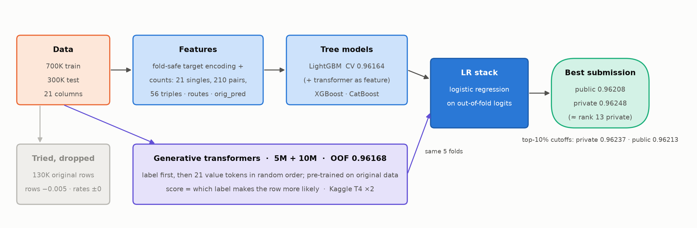

# Kaggle Playground S6E10: Predicting Airline Satisfaction

[Competition](https://www.kaggle.com/competitions/playground-series-s6e10): predict the probability that a passenger is satisfied, scored by ROC AUC. The data is synthetic, generated by GPT-2 (GReaT) from the classic Airline Passenger Satisfaction dataset. The competition closed on 2026-10-31, so these are late submissions (scored, not ranked). **Goal: top 10% of 3,735 teams.** On the private board (final standings, ~80% of the test set) the cutoff is 0.96237, and our best submission scores **0.96248, about rank 13 462**. On the public board (~20% of the test set) the cutoff is 0.96213 and we're at 0.96208.



## Experiments

| # | Experiment | Best OOF AUC | Public | Private | Verdict |
|---|---|---|---|---|---|
| 1 | [EDA and LightGBM baseline](experiments/experiment-01-eda-baseline/) | 0.95892 | 0.95836 | 0.95942 | Baseline; CV tracks the leaderboard |
| 2 | [Hand-made features vs target encoding](experiments/experiment-02-target-encoding/) | 0.96031 | 0.95982 | 0.96073 | Target encoding +0.0014 |
| 3 | [XGBoost, CatBoost and stacking](experiments/experiment-03-model-zoo-stacking/) | 0.96039 | | | Tree libraries barely blend |
| 4 | [Original dataset](experiments/experiment-04-original-dataset/) | 0.96028 | | | Dropped: rates flat, rows hurt |
| 5 | [All pairs + triples](experiments/experiment-05-all-pairs-triples/) | 0.96088 | 0.96027 | 0.96126 | +0.0006 |
| 6 | [Generative transformer v1](experiments/experiment-06-transformer-v1/) | 0.95790 (stack 0.96100) | 0.96035 | 0.96137 | Too weak to matter |
| 7 | [Transformer 5M](experiments/experiment-07-transformer-5m/) | 0.96125 (stack 0.96176) | 0.96161 | 0.96205 | Beats trees; stack +0.0013 public |
| 8 | [LightGBM tuning](experiments/experiment-08-lightgbm-tuning/) | 0.96097 | | | Saturated |
| 9 | [Counts, triples, routes, original-data model](experiments/experiment-09-extended-features/) | 0.96125 (stack 0.96186) | 0.96176 | 0.96215 | +0.0003 trees |
| 10 | [Pre-trained and larger transformers](experiments/experiment-10-pretrained-transformers/) | 0.96168 (stack 0.96216) | **0.96208** | **0.96248** | **Private top 10% (~rank 13)** |

## Layout

```
src/            all code; run from the repo root
  eda.py, figures.py, train_lgb.py   experiment 1
  train.py      tree models: --model lgb|xgb|cat, feature flags (--feats, --pairs, --counts, …)
  gen.py        generative transformer (MPS or CUDA, multi-GPU folds, --pretrain)
  make_kaggle_job.py, gen_collect.py   package gen.py as a Kaggle GPU job / collect its folds
  blend.py, stack_gbdt.py              logistic-regression stack / CatBoost stacker
experiments/    one folder per experiment: goal, exact commands, results, learnings
docs/           pipeline diagram (src/pipeline_diagram.py)
```

## Setup

```
uv sync
uv run kaggle competitions download -c playground-series-s6e10 && unzip playground-series-s6e10.zip
uv run kaggle datasets download -d arseniyshutko/binary-aviation-satisfaction-129k -p orig --unzip
```

On macOS, LightGBM and XGBoost need `brew install libomp`. Kaggle GPUs need a phone-verified account. Data, predictions (`preds/`) and Kaggle job folders are git-ignored.

Every model uses the same folds, `StratifiedKFold(5, shuffle=True, random_state=42)`, so their out-of-fold predictions line up row by row for stacking.
