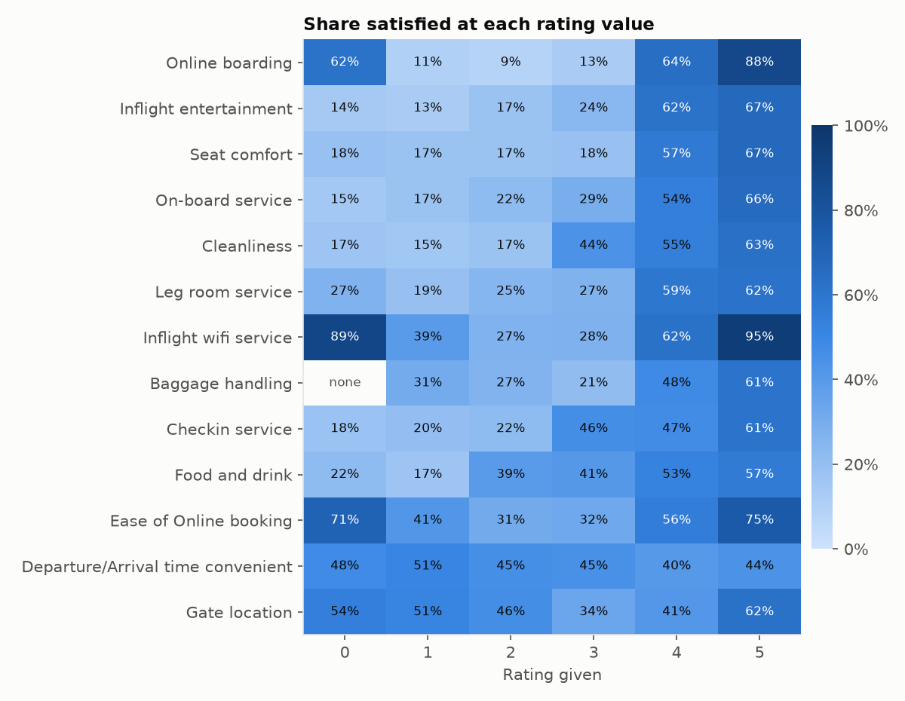
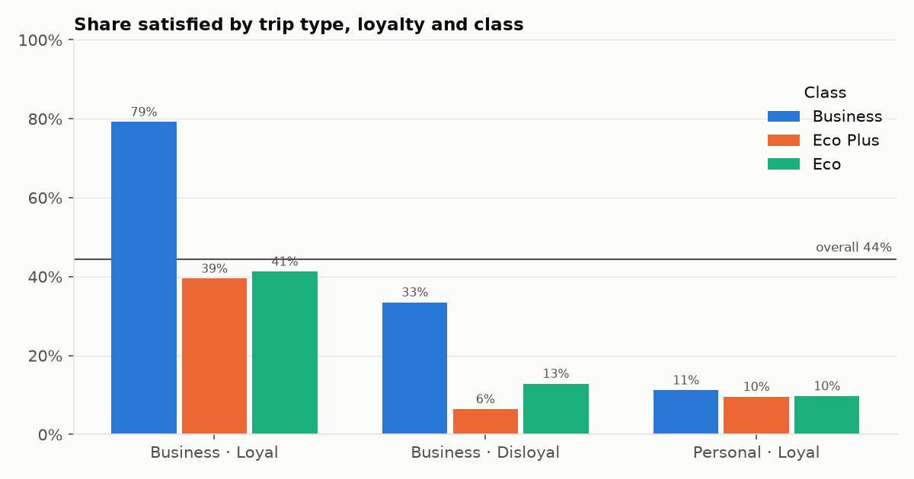
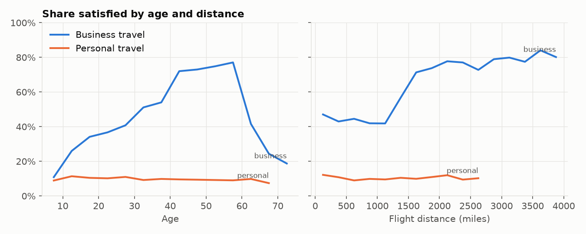
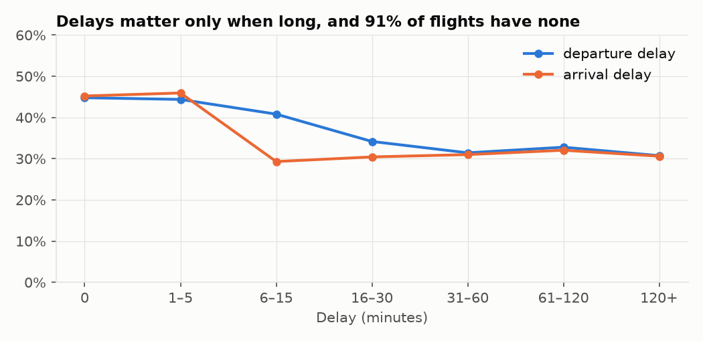
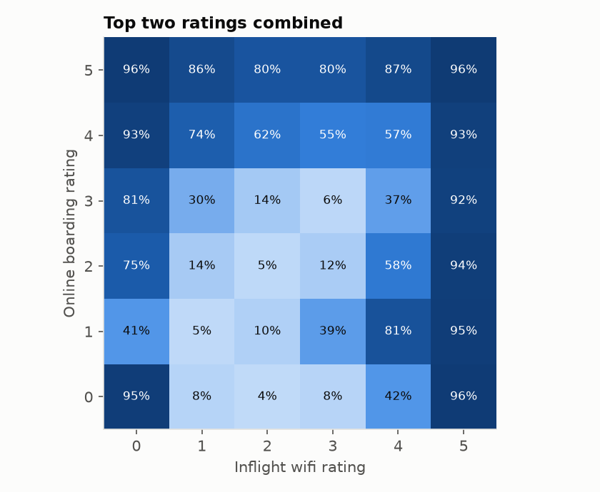

# Experiment 1: EDA and LightGBM baseline

**Goal:** understand the data, and get a cross-validated baseline we can trust against the leaderboard.

## Run

```
uv run python src/eda.py        # stats, single-feature AUCs, HistGradientBoosting holdout
uv run python src/figures.py    # charts below
uv run python src/train_lgb.py  # 5-fold LightGBM baseline -> sub_lgb.csv
```

## Results

| Model | OOF AUC | Public | Private |
|---|---|---|---|
| HistGradientBoosting, 20% holdout | 0.95785 | | |
| LightGBM, raw features, 5-fold | **0.95892** | **0.95836** | **0.95942** |

## Data facts

- 699,635 train rows, 299,844 test rows, 21 features: 13 ratings, age, flight distance, 2 delays and 4 categorical. 44.4% of passengers are satisfied.
- The only missing values are in `Arrival Delay in Minutes` (292 train, 130 test). There are no duplicate rows.
- Train and test match closely: the largest gap in any feature's mean is 0.004 standard deviations. CV and the leaderboard agree within about 0.0005, so **CV is the guide**, not the public score.
- Single-feature AUC: `Online boarding` 0.84, Inflight entertainment 0.75, Seat comfort 0.73. Delays, `Gate location` and departure/arrival time convenience are near random (0.51–0.53).
- The data is synthetic. Models on the original real dataset reach 0.99+, but here noise caps AUC around 0.963.

## What the charts show

### A 0 rating isn't a bad rating


- Most ratings rise steadily from 1 to 5. `Online boarding` goes from about 10% satisfied at ratings 1–3 to 88% at 5.
- **A 0 behaves nothing like a 1.** Passengers who rated wifi 0 are 89% satisfied. A 0 means "not applicable" (for example, no wifi on the flight). It's a separate category, not the bottom of the scale.
- Passengers with 3 or more zeros are 86–94% satisfied.

### Segments interact


- Loyal business travellers in Business class are 79% satisfied. In Eco or Eco Plus, about 40%.
- Personal travellers are about 10% satisfied **whatever their class**.

### Age and distance only matter for business trips


- For business travellers, satisfaction plateaus at about 75% for ages 40–58, then collapses past 60. Flights over ~1,200 miles jump from about 42% to about 75% satisfied.

### Delays mostly don't matter


- 91% of flights have no departure delay, and even long delays only move satisfaction from 45% to about 30%.

### The top two ratings interact strongly


- A wifi rating of 5 means 92–96% satisfied whatever the boarding rating. The middle of the grid is non-additive: boarding 3 with wifi 3 is 6% satisfied, while boarding 1 with wifi 4 is 81%.

## Learnings

- Value-level and pair-level patterns dominate, which points to treating values as categories and encoding pairs (experiment 2).
- Leaderboard context: 3,735 teams. The top 10% needs public 0.96213. The public top 3 (0.9645+) overfit the public split, and the private winner scored 0.96318.
